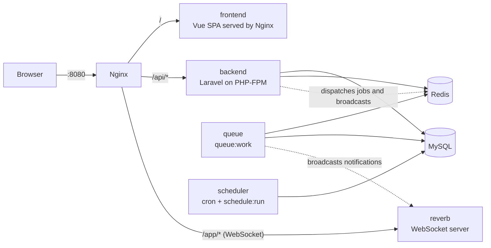

# Time Tracker

A full-stack time-tracking app. Log what you work on each day, see where your time goes, and share your days with teams in **channels** where members can follow along and comment. Notifications arrive in real time over WebSockets and by email. The interface is available in **English and Arabic** (with RTL layout).

Built as a learning project to practice designing a real multi-service application end to end: a Laravel REST API, a Vue 3 single-page app, background workers, a scheduler, WebSockets, and a Docker-based deployment.

## Features

**Time tracking**
- Log entries with a label, date, start time and end time; duration is calculated automatically.
- Search by label, filter by date, sort, and jump between days with a history sidebar.
- Edit and delete entries.

**Reports**
- Pick a date range and get quick stats: total entries, total time, active days and daily average.
- Time by label, top-5 most used labels (with an "Other" bucket), average time per label and labels per day.
- Bar and doughnut charts (Chart.js), plus a PDF report that includes the charts.
- Report queries are cached in Redis for 24 hours, with a manual refresh.

**Channels and sharing**
- Create channels, and browse the ones you own or have joined.
- Invite people by email or username. Invitations can be accepted, declined or cancelled, either in the app or straight from the email through signed links. Every state change is written to an invitation log.
- Channel owners share a day (choosing which entries to include) with one or more channels at once.
- Members view shared days, entries and totals, and discuss them in comments. Comment authors can edit their own comments; owners can moderate.

**Notifications**
- Six notification types (invitations, accepted invitations, new shared days, new comments, comments removed by the owner, export ready).
- Delivered in-app in real time through Laravel Reverb and Laravel Echo, and optionally by email.
- Per-type email preferences in Settings, plus one-click unsubscribe links in emails.
- A scheduled job prunes old read notifications.

**Exports**
- Time entries for a date range as CSV, XLSX or PDF.
- A single shared day (with its comments) as CSV, XLSX or PDF.
- A full channel export (members, shared days, comments) generated by a queued job, with a notification when the file is ready.

**Accounts**
- Register and log in with email and password, or sign in with Google.
- Forgot/reset password flow and a welcome email.
- Token authentication with Laravel Sanctum.

## Tech stack

| Layer | Technology |
| --- | --- |
| Backend | PHP 8.3, Laravel 10, Sanctum, Reverb, Socialite (Google) |
| Exports | Laravel Excel (CSV/XLSX), DomPDF (PDF) |
| Frontend | Vue 3, Vite, Pinia, Vue Router, vue-i18n, Tailwind CSS 4, Chart.js, Axios, Laravel Echo |
| Data | MySQL 8, Redis (cache and queues) |
| Infrastructure | Docker Compose, Nginx |

## Architecture



Everything is served from a single origin (`http://localhost:8080`): Nginx routes the SPA, the API and the WebSocket endpoint, so the browser needs no CORS configuration.

| Service | Role |
| --- | --- |
| `nginx` | Reverse proxy and the only published port (8080) |
| `frontend` | Production build of the Vue app, served by Nginx |
| `backend` | Laravel API on PHP-FPM; runs migrations and seeders on start |
| `queue` | `php artisan queue:work`: sends email and broadcast notifications, builds channel exports |
| `scheduler` | Cron running `schedule:run`: clears expired password resets, prunes notifications and failed jobs |
| `reverb` | Laravel Reverb WebSocket server for real-time notifications |
| `db` | MySQL 8 (data persisted in the `db_data` volume) |
| `redis` | Cache and queue backend |

### How the main flows work

- **Sharing a day:** the owner picks entries and channels, the API creates the `shared_day` and its entries in a transaction, then fires an event. A listener sends a queued notification to channel members (in-app, broadcast and optionally email, depending on each member's preferences).
- **Real-time notifications:** notifications use the `database` and `broadcast` channels. The SPA subscribes to the private channel `App.Models.User.{id}` through Echo, authorised via `/api/broadcasting/auth`, and updates the bell and list as messages arrive.
- **Authorization:** every resource is guarded by a Laravel policy (`TimeEntryPolicy`, `ChannelPolicy`, `SharedDayPolicy`, `CommentPolicy`, `InvitationPolicy`). Time entries are private to their owner; channels, shared days and comments are visible to the owner and members only; nested routes use scoped bindings so an id can't be reached through an unrelated parent. Invitation, unsubscribe and download links use signed URLs.
- **Side effects stay out of controllers:** model observers compute durations, write invitation logs and seed a new user's notification preferences; services hold the invitation and report logic.

## Getting started

### Prerequisites
- [Docker](https://docs.docker.com/get-docker/) with Docker Compose v2

### Run it

```bash
git clone git@github.com:maneer17/time-tracker.git
cd time-tracker
cp backend/.env.example backend/.env
docker compose up --build
```

The first start takes a few minutes: the backend container installs Composer dependencies, generates an app key, runs the migrations and seeds sample data. When the logs settle, open **http://localhost:8080**.

Log in with the seeded account:

| Email | Password |
| --- | --- |
| `test@example.com` | `password` |

(The seeder also creates ten other users, 20 channels, memberships, invitations and some time entries. All seeded users use the password `password`. The container runs `db:seed` on every start, but it only seeds a database that has no users yet, so restarting never duplicates anything.)

### Optional configuration

Edit `backend/.env`, then restart with `docker compose up -d`.

| Feature | What to set |
| --- | --- |
| Sending real email | `MAIL_MAILER=smtp` and the `MAIL_*` values (a [Mailtrap](https://mailtrap.io) sandbox works well). With the default `log` mailer, emails are written to `backend/storage/logs/laravel.log`. |
| Google Sign-In | Create a Google OAuth client, add `http://localhost:8080` as an authorized JavaScript origin, set `CLIENT_ID` and `CLIENT_SECRET` in `backend/.env`, and set `VITE_CLIENT_ID` in `frontend/.env.production`, then rebuild the frontend with `docker compose up -d --build frontend`. |
| Telescope debug dashboard | `TELESCOPE_ENABLED=true`, then visit `/telescope` on the backend. |

> The frontend's `VITE_*` variables are baked in at build time. If you change `REVERB_APP_KEY` in `backend/.env`, update `VITE_REVERB_APP_KEY` in `frontend/.env.production` to match and rebuild the frontend.

### Common commands

```bash
# Follow logs for one service
docker compose logs -f backend

# Run artisan commands
docker compose exec backend php artisan migrate:status

# Start over with a clean database
docker compose down -v && docker compose up --build

# Run the frontend with hot reload instead of the Docker build
cd frontend && npm install && npm run dev   # http://localhost:5173
```

For the Vite dev server, set `FRONTEND_URL=http://localhost:5173` in `backend/.env` so emailed links and invitation redirects point to it. It needs Node 20.19+ or 22.12+.

## Tests

The backend has a feature and unit test suite (PHPUnit) covering authentication, time entries, reports, channels, invitations, shared days, comments, notifications, exports, including the authorization rules above.

```bash
docker compose exec backend php artisan test
```

Tests run against an in-memory SQLite database, so they never touch your development data. The test bootstrap ignores Laravel's cached config and routes and refuses to start if the database isn't in-memory SQLite.

## API overview

All routes are under `/api` and, unless marked public, require a `Bearer` token from Sanctum.

| Area | Endpoints |
| --- | --- |
| Auth (public) | `POST /register`, `POST /login`, `POST /auth/google`, `POST /passwords/forgot-password`, `POST /passwords/reset-password`; authenticated: `POST /logout` |
| Time entries | `GET/POST /time-entries`, `GET/PUT/DELETE /time-entries/{id}`; list supports `date`, `search`, `sort` and `history=1` |
| Reports | `GET /reports?from=&to=&refresh=` |
| Channels | `GET/POST /channels`, `GET/PUT/DELETE /channels/{id}` (`type=owned\|joined`) |
| Invitations | `GET/POST /channels/{id}/invitations`, `PUT .../invitations/{id}` (body `status`: `accepted`, `declined` or `cancelled`); signed public links `GET /invitations/{id}/accept` and `/deny` |
| Shared days | `POST /shared-days`, `GET /channels/{id}/shared-days`, `GET/DELETE .../shared-days/{id}` |
| Comments | `GET/POST /shared-days/{id}/comments`, `PUT/DELETE .../comments/{id}` |
| Notifications | `GET /notifications`, `GET /notifications/unread-count`, `PUT /notifications/mark-all-as-read`, `PUT /notifications/{id}/read`, `DELETE /notifications/{id}` |
| Settings | `GET/PUT /settings/notification-preferences`; signed public link `GET /email/unsubscribe` |
| Exports | `GET /exports/time-entries`, `POST /exports/report`, `GET /exports/shared-days/{id}`, `GET /exports/channel-data/{id}`; signed `GET /exports/download/{user}/{file}` |
| Me | `GET /me/invitations`, `GET /me/shared-days` |

## Project structure

```
time-tracker/
├── docker-compose.yml        # all services
├── docker/
│   ├── nginx/default.conf    # routes /, /api and /app (WebSocket)
│   └── cron/scheduler        # runs `schedule:run` every minute
├── backend/                  # Laravel 10 API
│   ├── app/
│   │   ├── Http/             # controllers, form requests, API resources, middleware
│   │   ├── Models/           # Eloquent models and query scopes
│   │   ├── Policies/         # authorization rules
│   │   ├── Services/         # invitation + report business logic
│   │   ├── Events/ Listeners/ Notifications/ Observers/
│   │   ├── Jobs/             # background channel export
│   │   ├── Exports/          # Excel / CSV / PDF export classes
│   │   └── Console/          # scheduled commands
│   ├── database/             # migrations, factories, seeders
│   ├── tests/                # feature + unit tests (SQLite in memory)
│   ├── resources/views/      # PDF and email templates
│   └── routes/               # api.php, channels.php (broadcast auth)
└── frontend/                 # Vue 3 SPA
    └── src/
        ├── views/            # one component per page
        ├── components/       # channel, time-entries, charts, notifications, ...
        ├── stores/           # Pinia: auth, notifications, comments
        ├── services/         # Axios API wrappers, one per resource
        ├── composables/      # useApi, usePagination, useExport, ...
        └── locales/          # en.json, ar.json
```
